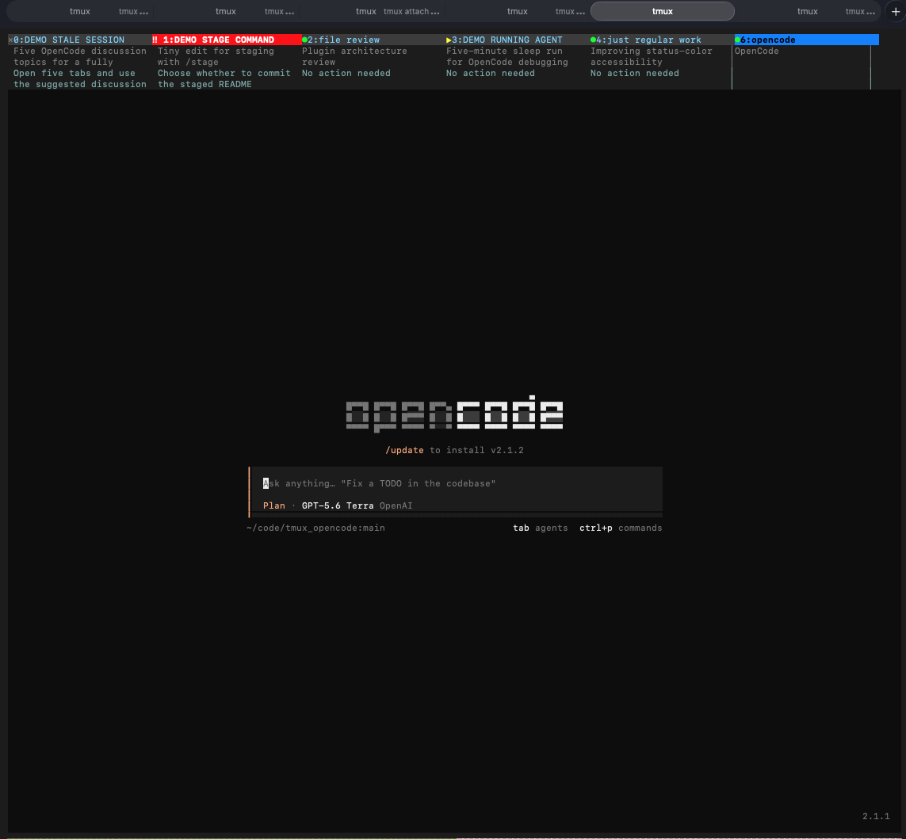

# tmux + OpenCode attention status

Portable configuration for showing OpenCode activity in tmux window tabs.

Small status signals keep active sessions easy to spot.



## What it shows

| Symbol | Meaning | Tab treatment |
| --- | --- | --- |
| `●` | Idle OpenCode session | Green |
| `▶` | Working session | Yellow |
| `◆` | Working for one minute or longer | Orange |
| `◐` | Aging session | Grey |
| `×` | Stale session | Grey |
| `‼` | `/stage` choice pending | Red |

The red `/stage` state is persistent until its menu is answered.

The status bar also includes two rows of session titles and two rows of the
next suggested user action.

## Requirements

- macOS or Linux with `tmux`
- [OpenCode V2](https://opencode.ai/)
- OpenCode launched from inside a tmux pane
- Bun, included with current OpenCode terminal installations

## Install

```sh
git clone <your-remote-url> ~/code/tmux_opencode
cd ~/code/tmux_opencode
./install.sh
```

The installer:

1. Copies the local OpenCode plugin to `~/.config/opencode/plugins/tmux-activity/`.
2. Adds that plugin to `~/.config/opencode/cli.json` without removing existing settings.
3. Installs the `/stage` command at `~/.config/opencode/commands/stage.md`.
4. Adds a managed `source-file` line to `~/.tmux.conf` and reloads tmux.

Restart OpenCode TUI sessions after installation so they load the plugin.

## Manual installation

Copy `opencode/plugins/tmux-activity/` and `opencode/commands/stage.md` to the
matching paths under `~/.config/opencode/`. Add the plugin directory to the
`plugins` array in `~/.config/opencode/cli.json`, then add this line to
`~/.tmux.conf`:

```tmux
source-file ~/code/tmux_opencode/tmux/opencode-activity.conf
```

Reload tmux with:

```sh
tmux source-file ~/.tmux.conf
```

## Test states

Run `/stage` in an OpenCode session with unstaged changes. Its initial approval
menu must open before any files are staged. While either `/stage` choice menu is
open, that tmux tab should become solid red with `‼`; it clears after you make a
choice.

## Updating

Pull the repository and run `./install.sh` again. The installer only replaces
files owned by this setup and preserves unrelated OpenCode CLI settings.
